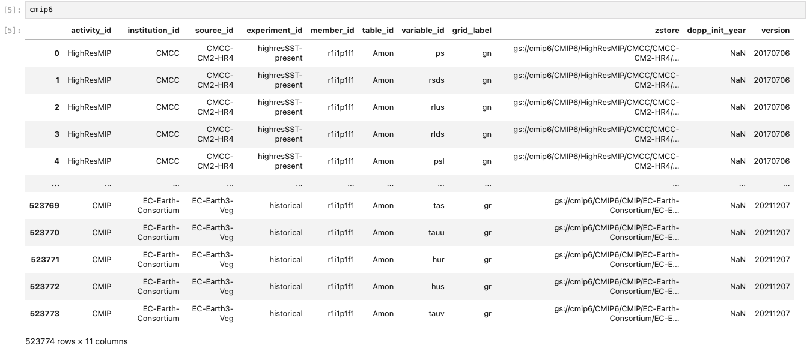
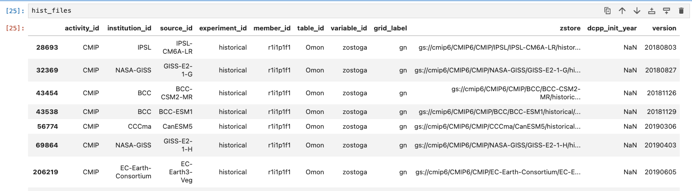
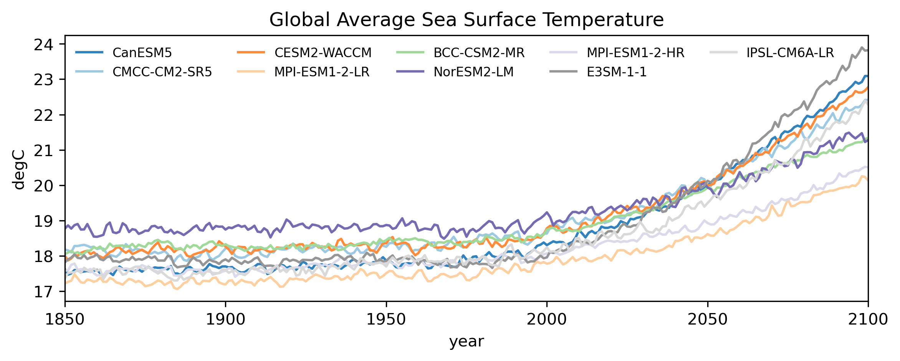
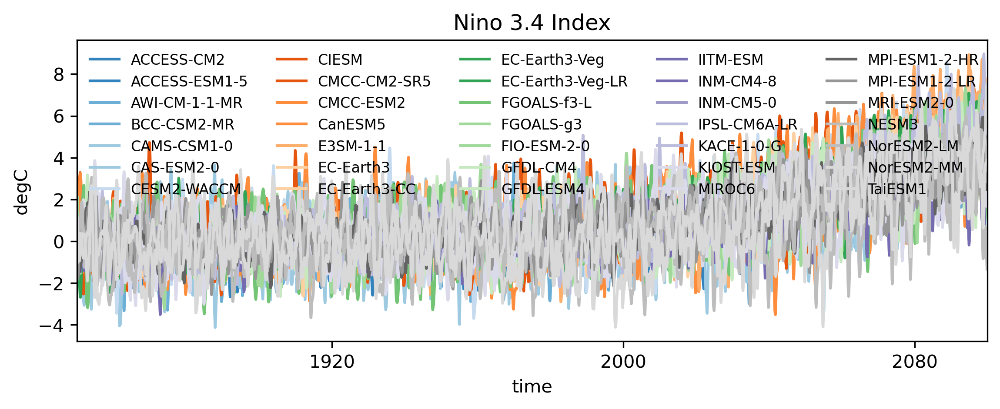
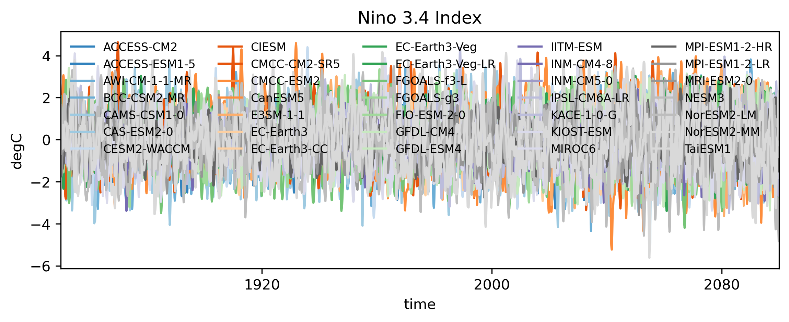
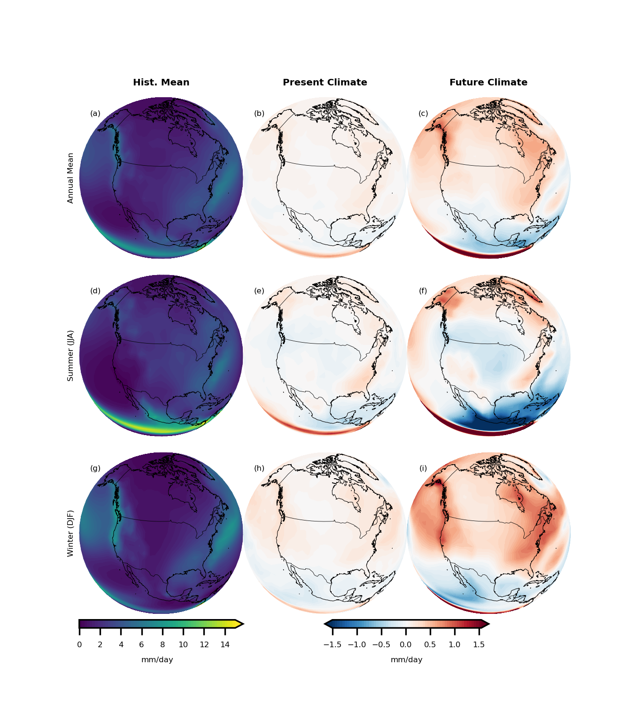

Climate change is one of the most urgent challenges facing humanity today. To plan effectively for a changing world, it’s crucial to understand how the climate is shifting and what those changes mean for our environment, economies, and communities. A large part of this understanding comes from climate modeling, most of which is funded by taxpayers and made freely available to the public.

One of the most important sources of climate model data is the Coupled Model Intercomparison Project ([CMIP](https://wcrp-cmip.org)), coordinated by the World Climate Research Programme ([WCRP](https://www.wcrp-climate.org)). Now in its sixth phase, CMIP6 provides a standardized framework for climate modeling experiments, bringing together outputs from dozens of models around the world. These simulations are essential for international climate assessments, including reports by the IPCC.

Although CMIP6 data is open access, working with it has traditionally been challenging due to its sheer size and complexity. With hundreds of variables, dozens of models, multiple future scenarios, and high-resolution spatial and temporal data, it's easy to feel overwhelmed—especially if you’re new to climate science or don’t have a strong programming background.

Fortunately, recent advances in tools and platforms have significantly lowered the barrier to entry. You no longer need to download terabytes of data or write complex code to get started. In fact, with a few Python commands and some user-friendly libraries, you can search, subset, and analyze CMIP6 data efficiently—often without downloading the full dataset.

To understand the structure of CMIP experiments and explore different ways to access the data, I recommend starting with the WCRP’s official [data access guide](https://wcrp-cmip.org/cmip-data-access/). In this tutorial, I’ll walk you through a simple, hands-on approach to accessing CMIP6 climate data using modern Python tools. You’ll learn how to extract just the information you need, perform basic analyses, and even create maps and plots—all with minimal setup. This guide is designed with beginners in mind, but some familiarity with Python will be helpful.

## What You’ll Learn

By the end of this tutorial, you’ll be able to:

1. Analyze [Global mean Sea Surface Temperature Changes](#global-mean-sea-surface-temperature-changes).
2. [Compute El Niño Southern Oscillation present and future periods](#compute-el-niño-southern-oscillation-present-and-future).
3. Evaluate [Future rainfall changes over North America](#future-rainfall-changes-over-north-america).

A complete version of this tutorial is also available as a [Jupyter Notebook](https://github.com/nbarjun/Blog/blob/main/download_cmip6_gcsfs.ipynb), so you can easily follow along, experiment, and explore at your own pace!

## What You’ll Need (Prerequisites)

Don’t worry if you’re not an expert coder—I’ll explain each tool and how it fits into the workflow. But some basic Python knowledge will help. Here’s what you’ll need to install:

1. Latest version of [Python](https://www.python.org). Make sure you’re using an up-to-date Python environment.
2. [netCDF4](https://unidata.github.io/netcdf4-python/): netcdf4 is a Python interface to the netCDF C library.
3. [Xarray](https://docs.xarray.dev/en/stable/): For working with labeled multi-dimensional arrays—perfect for climate data like temperature, precipitation, or sea level.
4. [Pandas](https://pandas.pydata.org/): Ideal for handling and analyzing tabular (spreadsheet-like) data formats. 
5. [Pyesgf](https://esgf-pyclient.readthedocs.io/en/latest/index.html): A Python client for searching and downloading CMIP6 data from the Earth System Grid Federation (ESGF).
6. [Zarr](https://zarr.dev): Enables fast access to chunked and compressed datasets stored in the cloud (especially useful when working with large files).
7. [GCSFS](https://gcsfs.readthedocs.io/en/latest/): A file system interface for accessing CMIP6 data stored on Google Cloud Storage (GCS).
8. [Matplotlib](https://matplotlib.org): A classic Python library for creating static plots and graphs.
9. [Cartopy](https://scitools.org.uk/cartopy/docs/latest/index.html): A mapping library for geospatial data—great for creating climate maps.
10. [Tqdm](https://tqdm.github.io): Adds a clean, customizable progress bar to your Python loops—especially useful when downloading or processing large datasets.
11. Other standard computational libraries like [numpy](https://numpy.org/install/) and [scipy](https://scipy.org/install/).

You’ll find a full list of the libraries and their versions [here](https://github.com/nbarjun/Blog/blob/main/conda_env_download_cmip6.yml). To make your life easier, I suggest using Anaconda environments—it's the best way to manage installations without running into messy dependency issues. To get started with Conda environments, follow this [official tutorial](https://docs.conda.io/projects/conda/en/latest/user-guide/tasks/manage-environments.html). 

---

## Accessing CMIP6 Data from Google Cloud Storage

Import the required packages:

```python 
# Packages Required to Browse and Analyze CMIP6 Data
from pyesgf.search import SearchConnection
import numpy as np
import pandas as pd
from tqdm import tqdm
import zarr
import gcsfs
import xarray as xr
import os
from string import ascii_lowercase

# Packages required for plotting
import matplotlib.pyplot as plt
import cartopy.crs as ccrs
import cartopy.feature as cfeature

# Set environmental variable for ESGF Search
os.environ["ESGF_PYCLIENT_NO_FACETS_STAR_WARNING"] = "on"
```

Once you import all the required packages, connect to the Google server and read all the metadata:

```python
# Start connection
conn = SearchConnection('[https://esgf-node.llnl.gov/esg-search](https://esgf-node.llnl.gov/esg-search)', distrib=True)

# Read cmip6 metadata
cmip6 = pd.read_csv('[https://storage.googleapis.com/cmip6/cmip6-zarr-consolidated-stores.csv](https://storage.googleapis.com/cmip6/cmip6-zarr-consolidated-stores.csv)')
```

The metadata looks like this:

{fig-alt="CMIP6 Metadata"}

In the following sections, I’ll show you how to search for specific variables using metadata and efficiently compute different metrics from the data.

---

## Global Mean Sea Surface Temperature Changes

Let’s start with a simple example. The CMIP6 dataset includes a variable called *tosga*, which stands for Global Average Sea Surface Temperature. You can browse the full list of available variables in the official [CMIP6 MIP tables](/assets/blog/CMIP6_MIP_tables.xlsx).

To begin, we’ll extract the metadata—including the file locations—for the monthly mean *tosga* variable from the CMIP6 archive stored on Google Cloud:

```python
# Query for all the historical data for the global mean SST
hist_files = cmip6.query("table_id == 'Omon' & variable_id == ['tosga'] \
                    & experiment_id ==['historical'] & member_id == ['r1i1p1f1']")
```

The list looks like this:

{fig-alt="Historical data"}

Similarly, extract the data for SSP5-8.5, which is a high emission scenario:

```python
ssp_files = cmip6.query("table_id == 'Omon' & variable_id == ['tosga'] \
                    & experiment_id ==['ssp585'] & member_id == ['r1i1p1f1']")
```

Now let's select those CMIP6 models that have data for historical experiment and future scenarios. This will help us plot a continuous time series:

```python
# Obtain available model names for historical dataset
hist_models = np.unique(hist_files['source_id'])

# Obtain available model names for SSP-5 8.5 dataset
ssp_models = np.unique(ssp_files['source_id'])

# Select models that are present in both Historical and SSP5-8.5 experiments
model_names = list(set(ssp_models) & set(hist_models))
```

Now that we have the list of models, let's move on to extracting the data. In the next step, we'll loop through each model, read both the historical data (1850–2014) and the SSP5-8.5 scenario data (2015–2100), and calculate the annual mean values. After extracting the datasets, we'll combine them along the time dimension to create a continuous record from 1850 to 2100:

```python
combined_data = []
for i in tqdm(range(len(model_names))):
    # Read the historical data and compute the annual mean
    hist_data = xr.open_zarr(hist_files[hist_files['source_id']\
                ==model_names[i]]['zstore'].item())['tosga'].groupby('time.year').mean('time')
    
    # Read the SSP 5-8.5 scenario data
    ssp_data = xr.open_zarr(ssp_files[ssp_files['source_id']\
                ==model_names[i]]['zstore'].item())['tosga'].sel(time=slice('2015-01-01','2100-12-31'))\
                .groupby('time.year').mean('time')
    
    # Combine along the time dimension and compute the annual mean
    combined_data.append(xr.concat([hist_data, ssp_data], dim='year'))
```

:::{.callout-tip}
### Pro Tip
Before running the full loop, test everything with just one model. This allows you to verify that data extraction and transformations function properly before processing the full ensemble.
:::

To make computations easier later on, we’ll add the model information directly into the combined dataset. Thanks to how `xarray` is designed, it uses [lazy loading](https://docs.xarray.dev/en/latest/internals/internal-design.html#lazy-loading)—meaning only metadata and coordinates are loaded initially, reading full array contents into memory only upon request:

```python
# Combine the data for all CMIP6 models and load the data
cmip_data = xr.concat(combined_data, dim='models').load()

# Add the model name information
cmip_data = cmip_data.assign_coords({'models': model_names})
```

Finally, let's plot the values:

```python
# Divide the colors in the tab20c colorscheme into the length of models
colors = plt.cm.tab20c(np.linspace(0, 1, len(cmip_data.models.values)))
models = cmip_data.models.values

fig, ax = plt.subplots(1, 1, figsize=(9, 3), dpi=300)

# Loop through each model and plot data
for m in range(len(cmip_data.models.values)):
    ((cmip_data.sel(models=models[m])))\
            .plot(ax=ax, label=models[m], c=colors[m], alpha=1)

# Set the proper limits along X-axis
ax.set_xlim(cmip_data['year'].values[0], cmip_data['year'].values[-1])
ax.set_ylabel('degC')
ax.legend(ncols=5, loc='upper left', fontsize=8, frameon=False)
ax.set_title('Global Average Sea Surface Temperature')
plt.show()
```

{fig-alt="Global Average Sea Surface Temperature"}

---

## Compute El Niño Southern Oscillation Present and Future

The [El Niño Southern Oscillation](https://www.ncei.noaa.gov/access/monitoring/enso/sst) (ENSO) is one of the most influential modes of climate variability, significantly affecting weather and rainfall patterns across the globe. To quantify ENSO, we usually calculate an index based on the anomalous area-averaged sea surface temperature (SST) over the Niño 3.4 region (located roughly between 5°N–5°S latitude and 170°W–120°W longitude).

Unlike the previous example where we worked with a pre-computed global average, in this case, we need to extract and calculate the ENSO index directly from global SST data. The good news is: we don’t need to download entire datasets to do this. Instead, we can compute the Niño 3.4 average for each time step directly during the data reading process.

Let’s define a function that reads the surface temperature field, selects the Niño 3.4 region, and calculates the area-weighted average:

```python
def extract_index(ds):
    '''
    Takes CMIP6 data as input and calculates area-averaged surface 
    temperature over the Nino 3.4 region.
    '''
    nino34_ts = ds['ts'].sel(lat=slice(-5, 5), lon=slice(190, 240)).load()
    nino34_ts = nino34_ts.weighted(np.cos(nino34_ts['lat'] * np.pi / 180))\
            .mean(dim=('lon', 'lat'))
    return nino34_ts
```

Next, retrieve all available data for monthly mean surface temperature (*ts*) over the Niño 3.4 region from both historical (1850–2014) and SSP5-8.5 (2015–2100) datasets:

```python
# Search for historical datasets
hist_files = cmip6.query("table_id == 'Amon' & variable_id == ['ts'] \
                    & experiment_id ==['historical'] & member_id == ['r1i1p1f1']")

# Search for SSP5-8.5 datasets
ssp_files = cmip6.query("table_id == 'Amon' & variable_id == ['ts'] \
                    & experiment_id ==['ssp585'] & member_id == ['r1i1p1f1']")

ssp_models = np.unique(ssp_files['source_id'])
hist_models = np.unique(hist_files['source_id'])
model_names = sorted(list(set(ssp_models) & set(hist_models)))

combined_data = []
for i in tqdm(range(len(model_names))):
    # Read historical data
    hist_data = xr.open_zarr(hist_files[hist_files['source_id']\
                ==model_names[i]]['zstore'].item())
    
    # Redefine the time axis to assist merging
    histime = xr.cftime_range(start='1850-01-01', freq='1MS', periods=len(hist_data['time']))
    hist_data = hist_data.assign_coords({'time': histime})\
                .sel(time=slice('1850-01-01', '2014-12-31'))
    hist_nino = extract_index(hist_data)
    
    # Read SSP5-8.5 data
    ssp_data = xr.open_zarr(ssp_files[ssp_files['source_id']\
                    ==model_names[i]]['zstore'].item())
    ssptime = xr.cftime_range(start='2015-01-01', freq='1MS', periods=len(ssp_data['time']))
    ssp_data = ssp_data.assign_coords({'time': ssptime})\
                .sel(time=slice('2015-01-01', '2099-12-31'))
    ssp_nino = extract_index(ssp_data)
    
    combined_data.append(xr.concat([hist_nino, ssp_nino], dim='time'))

# Combine and add models as another coordinate
cmip_data = xr.concat(combined_data, dim='models').assign_coords({'models': model_names})
```

Next, calculate the anomaly with respect to a reference period to obtain the ENSO index:

```python
# Reference period to calculate mean climatology
refperiod = slice('1850-01-01', '1949-12-31')

# Calculate temperature anomaly
nino_anom = cmip_data.groupby('time.month') - cmip_data.sel(time=refperiod)\
                                .groupby('time.month').mean('time')
```

Plot the raw temperature anomaly time series:

```python
colors = plt.cm.tab20c(np.linspace(0, 1, len(cmip_data.models.values)))
models = cmip_data.models.values

fig, ax = plt.subplots(1, 1, figsize=(9, 3), dpi=300)
for m in range(len(cmip_data.models.values)):
    ((nino_anom.rolling(time=3, center=True).mean('time').sel(models=models[m])))\
            .plot(ax=ax, label=models[m], c=colors[m], alpha=1)

ax.set_title('Nino 3.4 Index')
ax.set_ylabel('degC')
ax.set_xlim(cmip_data['time'].values[0], cmip_data['time'].values[-1])
ax.legend(ncols=5, loc='upper left', fontsize=8, frameon=False)
plt.show()
```

{fig-alt="Nino 3.4 TS anomaly"}

Optionally, we can detrend the surface temperature anomalies to remove the underlying long-term warming trend caused by climate change. This isolates natural variability from the background global warming signal. We apply a 4th-order polynomial trend removal:

```python
def polynomial_detrend(data):
    '''
    Applies a 4th order polynomial detrending.
    '''
    pcoef = np.polyfit(np.arange(len(data)), data, deg=4)
    ptrend = np.polyval(pcoef.T, np.arange(len(data)))
    return data - ptrend

# Apply detrending to obtain the ENSO Index
nino_index = xr.apply_ufunc(polynomial_detrend, nino_anom,\
            vectorize=True, input_core_dims=[['time']],\
            output_core_dims=[['time']])
```

Plotting the detrended Niño 3.4 index:

```python
colors = plt.cm.tab20c(np.linspace(0, 1, len(cmip_data.models.values)))
models = cmip_data.models.values

fig, ax = plt.subplots(1, 1, figsize=(9, 3), dpi=300)
for m in range(len(cmip_data.models.values)):
    ((nino_index.rolling(time=3, center=True).mean('time').sel(models=models[m])))\
            .plot(ax=ax, label=models[m], c=colors[m], alpha=1)

ax.set_title('Nino 3.4 Index (Detrended)')
ax.set_ylabel('degC')
ax.set_xlim(cmip_data['time'].values[0], cmip_data['time'].values[-1])
ax.legend(ncols=5, loc='upper left', fontsize=8, frameon=False)
plt.show()
```

{fig-alt="Detrended Niño 3.4 anomaly"}

---

## Future Rainfall Changes over North America

Precipitation (*pr*) is a key multidimensional driver for climate impact assessments. Because climate models utilize different native grids, we regrid (interpolate) all fields to a standardized 2.5° × 2.5° grid.

Query precipitation data for historical and SSP5-8.5 scenarios:

```python
hist_files = cmip6.query("table_id == 'Amon' & variable_id == ['pr'] \
                    & experiment_id ==['historical'] & member_id == ['r1i1p1f1']")
ssp_files = cmip6.query("table_id == 'Amon' & variable_id == ['pr'] \
                    & experiment_id ==['ssp585'] & member_id == ['r1i1p1f1']")

ssp_models = np.unique(ssp_files['source_id'])
hist_models = np.unique(hist_files['source_id'])
model_names = list(set(ssp_models) & set(hist_models))
```

Define the regridding function and construct the target reference grid:

```python
def regrid_to_target(source_da, target_da):
    """
    Interpolates source DataArray onto target grid coordinates.
    """
    return source_da.interp_like(target_da)

# Construct dummy target grid
lon = np.arange(0, 360, 2.5)
lat = np.arange(-90, 91, 2.5)
dummy_data = np.zeros([len(lon), len(lat)])
target_grid = xr.DataArray(dummy_data, coords={'lon': lon, 'lat': lat})
```

Iterate over each model, extract the North American region, interpolate onto the target grid, and concatenate:

```python
# Spatial domain bounding box for North America
latslice = slice(0, 90)
lonslice = slice(180, 360)

combined_data = []
for i in tqdm(range(len(model_names))):
    # Read Historical Data
    hist_data = xr.open_zarr(hist_files[hist_files['source_id']\
                ==model_names[i]]['zstore'].item())['pr']
    histime = xr.cftime_range(start='1850-01-01', freq='1MS', periods=len(hist_data['time']))
    hist_data = hist_data.assign_coords({'time': histime})\
                .sel(time=slice('1850-01-01', '2015-12-31'))
    hist_idata = regrid_to_target(hist_data.sel(lat=latslice, lon=lonslice),\
                          target_grid.sel(lat=latslice, lon=lonslice))
    
    # Read SSP5-8.5 Data
    ssp_data = xr.open_zarr(ssp_files[ssp_files['source_id']\
                    ==model_names[i]]['zstore'].item())['pr']
    ssptime = xr.cftime_range(start='2015-01-01', freq='1MS', periods=len(ssp_data['time']))
    ssp_data = ssp_data.assign_coords({'time': ssptime})\
                .sel(time=slice('2016-01-01', '2099-12-31'))
    ssp_idata = regrid_to_target(ssp_data.sel(lat=latslice, lon=lonslice),\
                        target_grid.sel(lat=latslice, lon=lonslice))
    
    combined_data.append(xr.concat([hist_idata, ssp_idata], dim='time'))

# Combine model array
cmip_data = xr.concat(combined_data, dim='models').assign_coords({'models': model_names})
```

Split the data into historical, present, and future epochs to evaluate seasonal climatology:

```python
hslice = slice('1980-01-01', '2009-12-31')
pslice = slice('2011-01-01', '2040-12-31')
fslice = slice('2070-01-01', '2099-12-31')

# Calculate seasonal climatology per window
hclim = cmip_data.sel(time=hslice).groupby('time.season').mean('time')
pclim = cmip_data.sel(time=pslice).groupby('time.season').mean('time')
fclim = cmip_data.sel(time=fslice).groupby('time.season').mean('time')
```

Generate orthographic spatial anomaly projections using Cartopy:

```python
plt.rcParams.update({'font.size': 4})
fig, ax = plt.subplots(3, 3, figsize=(4.5, 5), dpi=300, frameon=False,\
            subplot_kw={'projection': ccrs.NearsidePerspective(central_longitude=260.0,\
                        central_latitude=45.0, satellite_height=4e6)})

ax = ax.flatten()
plotd = [
    hclim.mean(dim=('models', 'season')),
    (pclim - hclim).mean(dim=('models', 'season')),
    (fclim - hclim).mean(dim=('models', 'season')),
    hclim.sel(season='JJA').mean('models'),
    (pclim - hclim).sel(season='JJA').mean('models'),
    (fclim - hclim).sel(season='JJA').mean('models'),
    hclim.sel(season='DJF').mean('models'),
    (pclim - hclim).sel(season='DJF').mean('models'),
    (fclim - hclim).sel(season='DJF').mean('models')
]

levs = [np.arange(0, 15.1, .25), np.arange(-1.5, 1.6, .05), np.arange(-1.5, 1.6, .05)] * 3
titles = ['Hist. Mean', 'Present Climate', 'Future Climate']
pl = []

for a in range(len(ax)):
    pl.append((plotd[a] * 86400).plot.contourf(ax=ax[a], transform=ccrs.PlateCarree(),\
                    add_colorbar=False, levels=levs[a]))
    ax[a].text(.1, .9, f'({ascii_lowercase[a]})',\
               transform=ax[a].transAxes, va='center', ha='center')
    ax[a].coastlines(lw=.25, resolution='50m')
    ax[a].add_feature(cfeature.BORDERS, lw=.2)
    ax[a]._frameon = False
    ax[a].set_title('')

plt.subplots_adjust(wspace=0, hspace=-.05)
for a in range(3):
    ax[a].set_title(titles[a], fontweight='bold')

stitles = ['Annual Mean', 'Summer (JJA)', 'Winter (DJF)']
for a in np.arange(0, len(ax), 3):
    ax[a].text(-0.05, .5, stitles[a // 3], transform=ax[a].transAxes,\
              rotation=90, va='center', ha='center')

cb_pos = ax[-3].get_position()
pos_cax = fig.add_axes([cb_pos.x0, cb_pos.y0 - .02, cb_pos.width, cb_pos.height / 20])
cb = plt.colorbar(pl[0], cax=pos_cax, orientation='horizontal', ticks=levs[0][::8])
cb.minorticks_off()
cb.set_label('mm/day')

cb_pos = ax[-1].get_position()
pos_cax = fig.add_axes([cb_pos.x0 - cb_pos.width / 2, cb_pos.y0 - .02, cb_pos.width, cb_pos.height / 20])
cb = plt.colorbar(pl[-1], cax=pos_cax, orientation='horizontal', ticks=levs[-1][::10])
cb.minorticks_off()
cb.set_label('mm/day')
```

{fig-alt="Seasonal Precipitation Anomalies"}